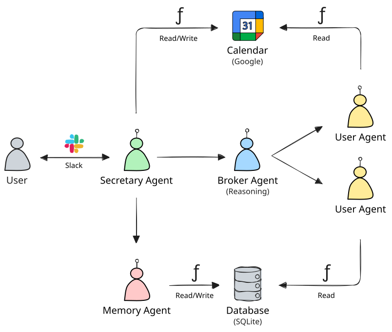

# QArrange (Implemented with Agno)

This repository contains an AI-agent-based tool assisting in scheduling meetings. It makes use of the AI agent
framework [Agno](https://github.com/agno-agi/agno) via Python.

> [!NOTE]  
> This project is just for demonstration purposes and, as is, not intended for production use.

## Goal

The goal is to assist users with finding time slots for meetings given the following constraints:

- Each user has a calendar with several blockers of varying importance.
- Each user has personal preferences regarding working hours, importance of specific meetings, etc.

## Features

- QArrange is a Slack app, providing an app home tab and offering a chatbot.
- The chatbot can be tasked with the scheduling of calendar events with other participants.
- The chatbot memorizes personal calendar preferences of the user. These preferences can be viewed and managed on the
  Slack app home tab.
- QArrange has access to calendars and can create events after successful scheduling.

## Agent Flow



### Event Scheduling

- A user queries the **Secretary Agent** via Slack, providing information about the meeting (title, desired
  date and time, duration, participants).
- The **Secretary Agent** makes sure that all necessary information is provided and asks for confirmation before
  proceeding. It then queries the **Broker Agent**.
- The **Broker Agent** requests available time slots from the individual **User Agents** and negotiates back and forth
  in case of conflicts, aiming for consensus.
- The **User Agents** (one per meeting participants) have access to user preferences and personal calendars and
  represent their users during the negotiation.
- After a working time slot has been reported back to the Secretary Agent, it will create a calendar event.

### Preference Memorization

- A user tells the **Secretary Agent** about any kind of preference regarding their calendar.
- The **Secretary Agent** asks the **Memory Agent** to store the provided preference.
- The **Memory Agent** rephrases the preference and stores it in a database.

## Tech Stack

- [Agno](https://github.com/agno-agi/agno)
- [slack-sdk](https://pypi.org/project/slack-sdk)
- [slack-bolt](https://pypi.org/project/slack-bolt) (in socket mode)
- Google Calendar
- SQLite (session storage, long-term memory)
- OpenAI language models

## Possible Next Steps

- Facilitate deployment to a cloud via proper Docker setup.
- Include participants in created calendar events (requires domain-wide delegation authority).
- Respect national holidays.
- Realize calendar integration via MCP.
- Use Agno's "human in the loop" feature for confirmation requests.

## Example Screenshots


## Example Logs

```
⚡️ Bolt app is running!
[SLACKUSERA] App home opened.
[SLACKUSERA/1747988191] Receiving message.
[SLACKUSERA/1747988191/SecretaryAgent] Initializing.
[SLACKUSERA/1747988191/SecretaryAgent] Initialize scheduling of event:
  Title: AI Session
  Date: next Thursday
  Duration: 2 hours
  Participants: ['SLACKUSERA', 'SLACKUSERB']
[SLACKUSERA/1747988191/BrokerAgent] Initializing.
[SLACKUSERA/1747988191/UserAgent/SLACKUSERA] Initializing.
[SLACKUSERA/1747988191/UserAgent/SLACKUSERB] Initializing.
[SLACKUSERA/1747988191/BrokerAgent] Negotiating.
[SLACKUSERA/1747988191/UserAgent/SLACKUSERA] Reading calendar at 2025-05-29.
[GoogleCalendar] Fetching blocker events at 2025-05-29 from calendar user-a@google.com.
[GoogleCalendar] Fetched 2 blocker events.
[SLACKUSERA/1747988191/UserAgent/SLACKUSERB] Reading calendar at 2025-05-29.
[GoogleCalendar] Fetching blocker events at 2025-05-29 from calendar user-b@google.com.
[GoogleCalendar] Fetched 1 blocker events.
[SLACKUSERA/1747988191/SecretaryAgent] Creating event.
[GoogleCalendar] Creating event in calendar user-a@google.com: {'summary': 'AI Session', 'description': 'Created by QArrange.', 'start': {'dateTime': '2025-05-29T13:00:00+02:00'}, 'end': {'dateTime': '2025-05-29T15:00:00+02:00'}}
[GoogleCalendar] Created event:  https://www.google.com/calendar/event?eid=my-event
[SLACKUSERA/1747988191] Responding to message.
```

## Local Execution

### First-time Setup

Make sure to have `python3.10` available, e.g., via `brew install python@3.10` on macOS. Using this version is a
workaround for an issue similar to [this](https://github.com/resemble-ai/resemble-enhance/issues/52).

```shell
python3.10 -m venv .venv
source .venv/bin/activate
pip install --upgrade pip
pip install -r requirements.txt
```

### Environment

Prepare your environment in [.env](.env) based on [.env.example](.env.example).

Furthermore, store credentials for a Google Cloud service account in
[google-calendar-service-account.json.secret](./google-calendar-service-account.json.secret). The account must be
permitted to assume the role "Service Account Token Creator".

### Execution

```shell
python main.py
```

### Observability

Run the Agno Agent OS:

```shell
python agent_os.py
```

In another terminal, run the Agno Agent UI:

```shell
npx create-agent-ui@latest
npm --prefix agent-ui run dev
```

## References

### Agno

- https://docs.agno.com/introduction

### Slack

- https://api.slack.com/docs
- https://tools.slack.dev/bolt-python
- https://app.slack.com/block-kit-builder

### Google

- https://developers.google.com/workspace/calendar/api/v3/reference