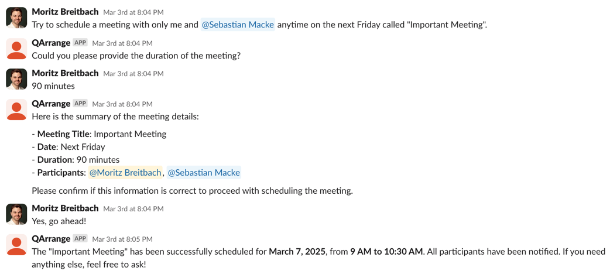
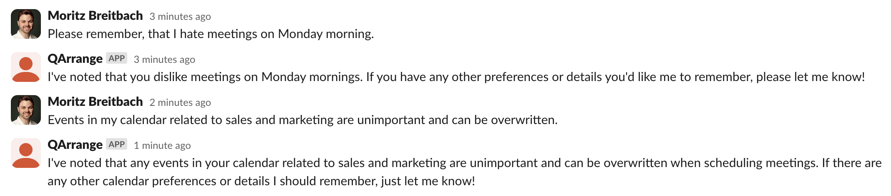
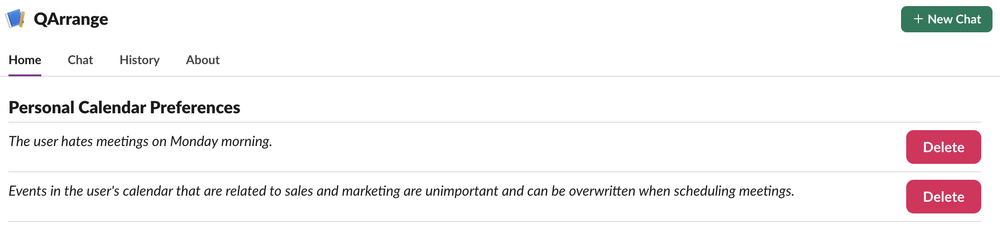

# QArrange (Implemented with Agno)

This repository contains an AI-agent-based tool assisting in scheduling meetings. It makes use of the AI agent
framework [Agno](https://github.com/agno-agi/agno) via Python.

## Goal

The goal is to assist users with finding time slots for meetings given the following constraints:

- Each user has a calendar with several blockers of varying importance.
- Each user has personal preferences regarding working hours, importance of specific meetings, etc.

## Features

- QArrange is a Slack app, providing an app home tab and offering a chatbot.
- The chatbot can be tasked with the scheduling of calendar events with other participants.
- The chatbot memorizes personal calendar preferences of the user. These preferences can be viewed and managed on the
  Slack app home tab.
- QArrange has access to calendars (not yet implemented, currently mocked).
- QArrange can create calendar events after successful scheduling (not yet implemented).

## Tech stack

- [Agno](https://github.com/agno-agi/agno)
- [slack-sdk](https://pypi.org/project/slack-sdk)
- [slack-bolt](https://pypi.org/project/slack-bolt) (in socket mode)
- SQLite (session storage, long-term memory)
- OpenAI language models

## Agent flow

### Event scheduling

- A user queries the **Secretary Agent** via Slack, providing information about the meeting (title, desired
  date and time, duration, participants).
- The **Secretary Agent** makes sure that all necessary information is provided and asks for confirmation before
  proceeding. It then queries the **Broker Agent**.
- The **Broker Agent** requests available time slots from the individual **User Agents** and negotiates back and forth
  in case of conflicts, aiming for consensus.
- The **User Agents** (one per meeting participants) have access to user preferences and personal calendars and
  represent their users during the negotiation.

### Preference memorization

- A user tells the **Secretary Agent** about any kind of preference regarding their calendar.
- The **Secretary Agent** asks the **Memory Agent** to store the provided preference.
- The **Memory Agent** rephrases the preference and stores it in a database.

## Possible next steps

- Calendar integration (currently mocked)
- Slack integration for feedback to the participants after successful scheduling
- Facilitate deployment to a cloud via proper Docker setup
- Proper structuring of the Python project

## Screenshots







## Local execution

### First-time setup

Make sure to have `python3.10` available, e.g. via `brew install python@3.10` on macOS. Using this version is a
workaround for an issue similar to [this](https://github.com/resemble-ai/resemble-enhance/issues/52).

```shell
python3.10 -m venv .venv
source .venv/bin/activate
pip install --upgrade pip
pip install -r requirements.txt
```

### Environment

Prepare your environment with the following variables:

```
SLACK_APP_TOKEN=xapp-...
SLACK_BOT_TOKEN=xoxb-...
OPENAI_API_KEY=sk-proj-...
```

### Execution

```shell
python main.py
```

## References

### Agno

- https://docs.agno.com/introduction

### Slack

- https://api.slack.com/docs
- https://tools.slack.dev/bolt-python
- https://app.slack.com/block-kit-builder